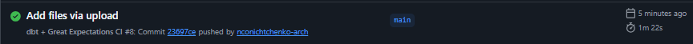

# E2E Data Quality Pipeline: dbt + Great Expectations + CI/CD

Демонстрация сквозного (E2E) пайплайна качества данных: **dbt** строит модель, **Great Expectations** проверяет её качество, а **GitHub Actions** автоматизирует весь процесс.

## Что это такое?

В современном DWH недостаточно просто построить модель. Нужно **гарантировать**, что данные в ней качественные (нет NULL, нет отрицательных значений, нет дублей). 

Этот проект показывает, как связать:
1. **dbt** — трансформация данных (модель `sales_summary`).
2. **Great Expectations** — проверки качества (NULL, диапазоны, уникальность).
3. **GitHub Actions** — CI/CD (при каждом пуше: dbt run → GX checks).

## Что реализовано

- **dbt-модель** `sales_summary.sql`: агрегация продаж по дням (количество заказов и выручка).
- **Great Expectations** (`gx_checks/run_gx_checks.py`): проверки для `sales_summary`:
  - `order_date` не NULL.
  - `total_orders` не NULL и > 0.
  - `total_revenue` не NULL и >= 0.
- **GitHub Actions** (`.github/workflows/dbt-gx-ci.yml`): автоматический запуск `dbt run` и `run_gx_checks.py` при каждом пуше.
- **Временная PostgreSQL** в CI: создается тестовая таблица `fct_sales`, чтобы dbt-модель могла выполниться.

## Стек

- dbt-core (dbt-postgres)
- Great Expectations
- PostgreSQL
- GitHub Actions
- Python (Pandas, SQLAlchemy)

## Как это работает

1. При пуше в `main` GitHub Actions запускает workflow.
2. Поднимается временная PostgreSQL (через `services`).
3. Создается схема `dbt_schema` и таблица `fct_sales` с тестовыми данными.
4. Запускается `dbt run` (создание модели `sales_summary`).
5. Запускается `run_gx_checks.py` (проверки качества данных).

Если проверки GX не проходят — workflow падает с красным крестиком. Если всё хорошо — зеленым.

## Скриншоты

**Успешный запуск CI/CD (dbt + GX):**

## Ссылки

- [Основной проект DWH Marketplace Analytics](https://github.com/nconichtchenko-arch/marketplace-dwh-analytics)
- [Data Contracts Demo](https://github.com/nconichtchenko-arch/data-contracts-demo)
- [dbt CI/CD Demo](https://github.com/nconichtchenko-arch/dbt-ci-cd-demo)
